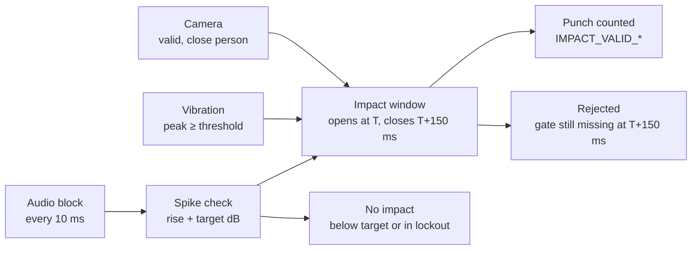

# Fusion Mode — How Punch Detection Works (Free Session)

As of 2026-10-29 · branch `audio_validation_improvements`
Code: `lib/features/session/presentation/controllers/free_session_controller.dart`

---

## Overview

In Fusion mode a punch is counted only when an **audio spike reaches its target dB**, and then, within one short **impact window**, **vibration** and **camera** both confirm it. Audio always starts the decision; vibration and camera can never count a punch on their own.

Fusion and Audio + Vibration both use the same impact-window path (`_usesImpactWindow`).

| Sensor | What it gives | Rate | Role in Fusion |
| --- | --- | --- | --- |
| Microphone | Peak level per block, on the app's 30–110 dB scale | One block every 10 ms (PCM sub-blocks) | Trigger: opens the impact window |
| Accelerometer | Vibration envelope in m/s² (gravity removed) | Sensor at 50 Hz (20 ms); stream throttled to ~33 ms or on a change of 0.02 or more | Gate: must reach the threshold inside the window |
| Camera (ML Kit pose) | Is a real person visible and close enough | Every processed camera frame | Gate: state must be `valid` when the decision is made |

A gate that is switched off is skipped, not failed:

- **Vibration** is skipped when the mount is Pole, or the vibration gate toggle is off.
- **Camera** is skipped when "vision confirmation" is off, or the camera failed to start (screen shows "Camera Offline — Audio Only").



Audio opens the window; vibration and camera feed into it. The punch counts the moment both pass, or is rejected when the window closes.

---

## Walkthrough — one punch, millisecond by millisecond

The numbers are **example values** with default settings: calibrated room level 55 dB, spike threshold 20 dB (so target = 75 dB), vibration threshold 0.06 m/s² (Android), camera on.

**A normal punch that counts:**

1. **0–200 ms:** session warm-up; nothing is checked.
2. **Before the punch:** the camera sees the user close enough for 3 frames in a row, so its state is `valid`. The microphone sends a level every 10 ms (about 55–60 dB).
3. **T = 5000 ms, glove hits the bag.** The audio block reads 92 dB; the block before was 60 dB.
    - Rise = 32 dB, more than 6 dB → sharp rise OK.
    - 92 dB is above the 75 dB target → loud enough.
    - So this is a **target spike**. An impact window opens from 4900 ms (T − 100) to 5150 ms (T + 150).
    - The spike lockout starts: no new spike can be detected until 5160 ms.
4. **5030 ms:** a vibration value of 0.40 m/s² arrives. It is inside the window and above 0.06 → vibration OK.
5. **5030 ms, same moment:** the camera state is still `valid` → camera OK.
6. **All gates pass → decided at once** (`decided_after_ms` = 30). Code `IMPACT_VALID_AUDIO_VIBE_CAM`, punch #1 counted, phone haptic fires.
7. **5000–5160 ms:** the punch lockout runs. Any sound in this time is ignored.
8. **Logs written:** `audio` lines every 10 ms, `vibe` lines, one `decision` line, one `punch` line, and one `IMPACT` row in the summary CSV.

**Other cases, same starting point:**

| Case | What happens | Result | What the summary CSV shows |
| --- | --- | --- | --- |
| Soft hit on a corner of the bag | Audio 82 dB OK, camera OK, but the highest vibration in 4900–5150 ms is 0.04 | Waits until 5150 ms, then rejected. Lockout released, so the next punch is not blocked | `IMPACT_REJECTED_NO_VIBRATION`, `vibe_peak` 0.04 < `vibe_threshold` 0.06 |
| User standing too far | Audio and vibration OK, camera state `tooFar` | Rejected at 5150 ms | `IMPACT_REJECTED_CAMERA_TOO_FAR`, low `distance_ratio` |
| Clap or light tap (70 dB) | Sharp rise OK, but 70 < 75 dB target | Not counted; lockout released at once | `AUDIO_BELOW_TARGET` |
| Talking, music getting louder slowly | No 6 dB jump in one block, no 10 dB rise in 40 ms | Never becomes a spike | Nothing. Only raw `audio` lines in the JSONL |
| Fast 1-2, second hit at 5120 ms | 5120 is inside the lockout (until 5160) | Second hit is not seen at all | Nothing. Only raw `audio` lines |
| 1-2, second hit at 5200 ms | New window 5100–5350 ms. The first hit's vibration is still fading: about 0.10 at 5100 ms | Counted, **even if the second hit gave no vibration** | `IMPACT_VALID_AUDIO_VIBE_CAM`, `vibe_peak` just above threshold |
| Settings sheet open, or closed less than 1 s ago | Every spike is refused | Not counted | `SETTINGS_OPEN_GATE` |

---

## Step 1 — Audio spike detection

Every 10 ms audio block is checked by `AdaptiveAudioBaseline.processFrame()`. A block becomes a **spike** only if it rises sharply **and** is loud enough.

**Where the levels come from.** `RecordAudioLevelService` reads raw PCM16 audio (16 kHz on Android, 44.1 kHz on iOS) and splits it into 10 ms blocks. Each block gives its peak level, mapped to the app scale as `dB = 1.25 × dBFS + 35`, clamped to 30–110. Every block is back-dated to when the sound happened, not when it arrived, so all timing below uses the real sound time.

**Warm-up.** For the first 200 ms of a session nothing is evaluated (`warmUpDurationInMiliSeconds`), so the screen-tap sound is ignored.

**Rule 1 — sharp rise (onset).** At least one of these must be true:

- jump from the previous block is 6 dB or more, or
- rise over the last 4 blocks (40 ms) is 10 dB or more, or
- rise over 40 ms is 8 dB or more **and** the jump from the previous block is 4 dB or more.

**Rule 2 — loud enough (target).** `target = customTargetAudioDb` if the user set one, otherwise `calibrated ambient dB + spike threshold dB`. The calibrated ambient level is measured once in the pre-check and does not change during the session. The block must also be above a safety floor (60 dB by default, never above the target).

| Result | Condition | What happens next |
| --- | --- | --- |
| No spike | Rule 1 fails, or the block is below calibration + 4 dB | Nothing is logged as a decision; only the raw `audio` event is saved |
| Below-target spike | Rule 1 passes, level is 4 dB+ over calibration but under target | Logged as `AUDIO_BELOW_TARGET` (candidate); the cooldown is released at once |
| Target spike | Rule 1 and Rule 2 pass | Opens an impact window (Step 3) |

The spike is confirmed on the **first** block that passes, which is not always the loudest block of the hit. The audio decay check described in the class comments (`minDecayPercentage`, `maxDecayMs`) is not implemented.

---

## Step 2 — Cooldowns (refractory)

Two counted punches can never be less than **160 ms** apart in Fusion mode. That is the one cooldown that actually limits counting.

| Cooldown | Value | Starts when | Released early? | Applies in Fusion? |
| --- | --- | --- | --- | --- |
| Spike lockout (`AdaptiveAudioBaseline.refractoryMs`, set from `AppConstants.audioRefractoryMs`) | 160 ms | Any spike, target or below-target | Yes: for a below-target spike, and for a rejected impact (except `IMPACT_REFRACTORY` and `IMPACT_ALREADY_PENDING`). **Not** released after a valid punch | Yes: during the lockout no new spike is even detected |
| Punch lockout (`_lastAudioPunchTimestampMs`) | 160 ms | A punch is registered | No | Yes: a spike inside it is rejected as `IMPACT_REFRACTORY` |
| Settings gate | While a settings sheet is open, plus 1000 ms after it closes (`postSettingsCooldownMs`) | Settings sheet opened | No | Yes: every impact is rejected as `SETTINGS_OPEN_GATE` |
| Session warm-up | 200 ms | Session start | No | Yes |
| Vibration re-arm | 110 ms | A punch is registered | No | No: only used to count punches in Vibration-only mode |
| Camera-only punch | 280 ms | A punch is registered | No | No: Camera-only mode |
| `FastComboFusionSynchronizer` (140 ms alternating arm, 210 ms same arm) | — | — | — | No: it is created but never called |

Because the spike lockout is released after a rejection, a clap or a below-target sound does not block a real punch that follows it. After a **valid** punch the full 160 ms always runs, so the second hit of a 1-2 thrown faster than 160 ms is not detected at all: no spike, no decision, nothing in the summary table.

---

## Step 3 — Impact window (merging the sensors)

A target spike at sound time **T** opens one impact window. Vibration is accepted from **T − 100 ms to T + 150 ms**; the camera must be `valid` when the decision is made. The punch is decided **as soon as** every required gate passes, or rejected at **T + 150 ms** if one is still missing.

| Setting | Value | Source |
| --- | --- | --- |
| Vibration accepted before the spike | 100 ms | `AppConstants.impactVibrationBeforeMs` |
| Vibration accepted after the spike (window length) | 150 ms | `min(impactVibrationAfterMs = 150, audioRefractoryMs − 10 = 150)` |
| Camera observation still counts for | 700 ms | `AppConstants.cameraObservationStaleMs` |
| Open impacts at the same time | 1 | `_pendingImpact` |

**How the window is checked.** `_evaluatePendingImpact()` runs when the window opens, then again on every vibration sample and every audio block (about every 10 ms). Each run:

1. Takes the highest vibration value stored between T − 100 and T + 150 and compares it with the vibration threshold.
2. Reads the current camera state (see Step 5).
3. Passes both to `ImpactGateEvaluator.evaluate()`:
    - all required gates OK → **valid**, punch registered now;
    - a gate missing and the window still open → **pending**, wait for the next sample;
    - a gate missing and "now" is past T + 150 → **rejected** with the code of the missing gate.

**What "now" means.** The window's clock is the latest sensor timestamp seen (`_eventClockMs`). Audio blocks carry the back-dated sound time; vibration samples carry the time they arrived in Dart. So vibration tends to look a little *later* than the audio it belongs to; the 150 ms after-allowance absorbs that.

**Second spike while one is pending.** It is rejected as `IMPACT_ALREADY_PENDING`. In practice this almost never happens: the spike lockout (160 ms) is longer than the window (150 ms), and an expired window is closed before a new block is checked.

**Typical decide times** (field `decided_after_ms` in the logs):

- vibration arrived before or with the audio and camera is valid → about 0 ms;
- vibration arrives late → the moment it arrives, up to 150 ms;
- a gate never passes → 150 ms or a little more (the next sample after T + 150).

---

## Step 4 — Vibration: measured, kept, never used up

Vibration is a hard gate in Fusion: if no stored vibration value in T − 100 to T + 150 ms reaches the threshold, the punch is rejected (`IMPACT_REJECTED_NO_VIBRATION`). Stored vibration is **not** used up when a punch counts, so one strong hit keeps the gate open for the next ~250 ms.

**How a value is made** (`DeviceVibrationService`, 50 Hz):

1. Read the user accelerometer (gravity already removed by the OS).
2. Remove slow drift per axis with a running average (α = 0.95).
3. Magnitude = √(x² + y² + z²). Anything under **0.10 m/s²** is set to 0 (deadband).
4. Envelope: a higher value is taken at once; otherwise `new = 0.7 × old + 0.3 × current`, and under 0.01 becomes 0.
5. Send the envelope to the controller every 33 ms, or sooner if it changed by 0.02 or more.

**Thresholds.** Default 0.06 m/s² on Android, 0.18 m/s² on iOS; the slider runs 0.05–1.0. On Android the threshold sits *below* the 0.10 deadband, so in practice any raw bump of 0.10 or more passes, and so does its fading tail.

**How fast it fades (dissolves).** After a hit with peak P and no further shaking, the envelope falls by 30% every 20 ms sample:

| Time after the hit | Envelope (share of P) |
| --- | --- |
| 40 ms | 49% |
| 80 ms | 24% |
| 120 ms | 12% |
| 160 ms | 6% |

**What happens to vibration after a punch counts.**

- `consumeRecentPeak()` clears the service's 600 ms "recent peak". That value is only used for log text and the `level.vibe_peak_at_punch` statistic.
- The impact window reads `_vibeHistory` (every received value, kept 2 s). It is **never cleared** per punch.
- Example: a hit with P = 1.0 m/s² at time 0. The next spike can come at 160 ms; its window starts at 60 ms, where the envelope is still about 0.34 m/s², above both default thresholds. So the second spike passes the vibration gate on the *first* hit's vibration.

This helps fast combos, but it also means any sound 160–250 ms after a real punch (glove slap, echo, shout) gets a free vibration pass.

**When vibration is not required** (`isVibrationEffectivelyDisabled`): mount type Pole, or the vibration gate toggle is off. Turning the toggle off also stops the accelerometer.

---

## Step 5 — Camera gate

In Fusion the camera checks **who is there**, not **whether they punched**. The gate passes when a real person is visible and close enough, and has been for 3 frames in a row. The camera's punch-motion detector (`TemporalPunchDetector`, arm-extension FSM) is logged but is not required to count a punch.

Each camera frame goes through these checks in order; the first that fails sets the camera state:

| # | Check | Rule (defaults) | State if it fails |
| --- | --- | --- | --- |
| 1 | Pose found | ML Kit returns a pose | `noPerson` |
| 2 | Real person | At least one face point and one shoulder, each with confidence ≥ 0.5, face above the shoulder | `noPerson` ("not a person") |
| 3 | Distance measurable | Both shoulders (or both eyes) with confidence ≥ 0.5. If neither, distance is unknown and counts as **not** valid (`cameraDistanceUnknownIsValid = false`) | `tooFar` |
| 4 | Close enough | Shoulder width ÷ image diagonal ≥ `0.16 ÷ Max Camera Distance`. Default Max Camera Distance is 0.8 m, so the ratio must be ≥ 0.20. Eye span uses the same rule, scaled | `tooFar` |
| 5 | Steady | 3 close frames in a row (`cameraMinConsecutiveNearFrames`); any failed frame resets the count | `tooFar` ("near n/3 frames") |
| — | All passed | | `valid` |

**At decision time** the impact window reads the latest camera state:

- camera not used (mode, vision confirmation off, or failed to start) → `notRequired`, gate skipped;
- camera still starting → `notReady`;
- no camera result for more than 700 ms → treated as `noPerson`;
- otherwise the last state seen (`valid`, `tooFar`, `noPerson`).

The stricter face/shoulder checks behind `enableExtraFaceRestrictions` are off by default. The max distance can be changed live from the session settings sheet (0.4–3.0 m).

---

## Decision codes

Every spike that reaches Step 3 ends with exactly one code. It appears as `code` in the raw log and in the summary CSV. Codes starting `IMPACT_VALID` count a punch; all others do not.

| Code | Counted | Meaning | Decided at |
| --- | --- | --- | --- |
| `IMPACT_VALID_AUDIO_VIBE_CAM` | Yes | Audio + vibration + camera all confirmed | When the last gate passes (0–150 ms) |
| `IMPACT_VALID_AUDIO_VIBE` | Yes | Camera not used; audio + vibration confirmed | Same |
| `IMPACT_VALID_AUDIO_CAM` | Yes | Vibration not used (Pole or gate off); audio + camera confirmed | Same |
| `IMPACT_VALID_AUDIO_ONLY` | Yes | Neither vibration nor camera used | At once |
| `AUDIO_BELOW_TARGET` | No (candidate) | Sharp sound, but under the target dB | At once |
| `IMPACT_REFRACTORY` | No | Spike inside the 160 ms punch lockout | At once |
| `IMPACT_ALREADY_PENDING` | No | Another impact still being decided | At once |
| `SETTINGS_OPEN_GATE` | No | Settings sheet open, or within 1 s of closing it | At once or during the window |
| `IMPACT_REJECTED_NO_VIBRATION` | No | Camera OK, no vibration ≥ threshold in T − 100 to T + 150 ms | T + 150 ms |
| `IMPACT_REJECTED_CAMERA_NO_PERSON` | No | Vibration OK, camera saw no valid person (or result older than 700 ms) | T + 150 ms |
| `IMPACT_REJECTED_CAMERA_TOO_FAR` | No | Vibration OK, person too far, distance unknown, or not yet 3 near frames | T + 150 ms |
| `IMPACT_REJECTED_CAMERA_NOT_READY` | No | Vibration OK, camera still starting | T + 150 ms |
| `IMPACT_REJECTED_NO_VIBRATION_NO_CAMERA` | No | Both gates failed | T + 150 ms |

A sound that fails Rule 1 (no sharp rise) or is less than 4 dB over the calibrated level gets **no code at all**. It only exists as raw `audio` samples.

---

## Logging

Each session writes three files, shared together from the Results page ("export logs" → system share sheet). The raw JSONL file is saved in `<app documents>/session_logs/`, which the OS does not clear; the newest 20 sessions are kept and older files are deleted when a new session starts. The TXT and CSV are rebuilt into the temporary folder each time you export.

| File | What it holds | Use it for |
| --- | --- | --- |
| `hyper_hitter_raw_events_<start>.jsonl` | Every sensor sample and every decision, one JSON object per line. Written by `SessionEventRecorder`, flushed every 1 s (if the app is killed, up to the last second is lost) | Replaying a session; finding sounds that never became a decision |
| `hyper_hitter_summary_<time>.csv` | One row per impact decision, per camera state change, and per hit hidden by the lockout. Max 3000 rows | Quick review in Excel or Sheets |
| `hyper_hitter_punch_log_<time>.txt` | Confirmed punch lines, the text spike log (500 lines; punch lines never dropped), session totals | Reading the session as text |

Recording never affects detection: no recorder call can throw, and nothing it stores is read back by the detector.

### Raw event file (JSONL)

Every line has `t` (ms since session start), `e` (epoch ms) and `k` (kind), plus:

| Kind | When | Fields |
| --- | --- | --- |
| `session_start` | Once | Full config: mode, mount, targetDb, spikeDb, calibratedDb, vibeThreshold, vibeGate, visionRequired, cameraMaxDistanceM, audioRefractoryMs, subBlockPcm, warmupMs, OS |
| `audio` | Every 10 ms block (time = sound time) | `db`, `chunk`, `clipped`, `lagMs` (delivery delay) |
| `vibe` | Every vibration value the detector received (throttled, time = arrival) | `mag`, `above` (over threshold), `rise` (first sample over it) |
| `vibe_raw` | Every accelerometer reading, about 50 per second (time = **sensor** time) | `raw` (before deadband), `eff` (after deadband), `env` (smoothed envelope), `lagMs` (sensor → Dart delay) |
| `spike_suppressed` | A sharp sound (passes the rise rule, 4 dB+ over calibration) ignored because of the 160 ms lockout | `db`, `frameJump`, `windowRise`, `targetMet`, `msSinceLastSpike`, `msSinceLastPunch` |
| `cam` | Every frame that passes the person and distance checks | `conf`, `punch`, `arm`, `fsm`, `distRatio`, `distSrc` |
| `cam_invalid` | Every frame that fails a camera check | `reason` |
| `decision` | Every spike that reached Step 3 (time = spike time) | `code`, `valid`, `candidate`, `peakDb`, `baselineDb`, `riseDb`, `frameJump`, `windowRise`, `onsetRule` (`jump6` / `rise10` / `rise8jump4`), `targetDb`, `vibeState`, `vibeWindowPeak`, `vibePeakAtMs`, `vibePeakOffsetMs` (vibration peak minus spike time; negative = before), `vibeRoseInWindow` (false = only a fading tail), `vibeThreshold`, `cameraState`, `cameraRatio`, `cameraDetail`, `decidedAfterMs`, `processingLagMs`, `msSinceLastPunch` |
| `punch` | Every counted punch | `n`, `status`, `arm`, `interPunchMs`, `vibePeak`, `audioDb` |
| `settings` | Settings sheet opened or closed | `open`, `count` |
| `config_change` | Any setting changed during the session | `reason` + full config |
| `reset` | Reset button | `previousCount` |
| `session_end` | Finish | `punches`, `durationSec`, `events`, `dropped`, `totals` |

### Summary CSV columns

`time, kind, code, valid, punch_no, audio_db, target_db, frame_jump, window_rise, vibe_peak, vibe_threshold, vibe_offset_ms, vibe_rose, camera_state, face_conf, shoulder_conf, distance_ratio, decided_after_ms, detail`

`kind` is:

- `IMPACT`: a decision row;
- `CAMERA`: a camera state change (for example `CAMERA_TOOFAR` → `CAMERA_VALID`);
- `SUPPRESSED`: a sharp sound hidden by the lockout, code `SPIKE_SUPPRESSED_LOCKOUT`. Only added when it came 60 ms or more after the previous spike, so the tail of the same hit does not fill the table; the raw file has every one.

`vibe_rose = no` on a valid row means the vibration gate was passed only by the fading tail of an earlier hit.

### Session totals

Printed at the end of the TXT file and stored in `session_end`. The most useful ones:

- **Counters:** `audio.frames`, `audio.saturated_frames`, `audio.spikes_seen`, `audio.spikes_target_met`, `audio.spikes_suppressed`, `audio.spikes_suppressed_target_met`, `audio.refractory_blocks`, `impact.opened`, `impact.vibe_tail_only`, `impact.valid` / `impact.rejected` / `impact.candidate`, `decision.IMPACT.<code>`, `punch.registered`, `vibe.threshold_crossings`, `cam.not_person_frames`, `cam.too_far_frames`, `cam.invalid_frames`, `time.camera_unavailable_ms` (shown as % of tracked time).
- **Min / avg / max series:** `level.audio_db_idle`, `level.vibe_mag_idle`, `level.audio_db_at_punch`, `level.vibe_peak_at_punch`, `interval.inter_punch_ms`, `interval.audio_chunk_ms`, `interval.vibe_stream_ms`, `lag.impact_decided_after_ms` (every impact), `lag.vibe_peak_minus_audio_ms`, `lag.vibe_sensor_to_dart_ms`, `cam.shoulder_ratio`, `cam.best_face_conf`, `cam.best_shoulder_conf`.

---

## Diagnosing missed and extra punches from the logs

The reason for almost every miss can be found from the logs, but only if you know **when** the punch was thrown. The logs record what the sensors saw, not what the boxer did. For a test session, record a video or note the time of each missed punch, then match it to `t` in the raw file or `time` in the CSV.

### Step A — is there a decision row near that time?

Open the summary CSV and look within ±300 ms of the punch.

| What you find | Cause | What to check | Usual fix |
| --- | --- | --- | --- |
| `IMPACT_REJECTED_NO_VIBRATION` | Phone did not feel the hit | `vibe_peak` vs `vibe_threshold`; `level.vibe_mag_idle` in totals | Lower the vibration threshold, check the mount, or switch off the vibration gate |
| `IMPACT_REJECTED_CAMERA_TOO_FAR` | User too far, distance not measurable, or not 3 near frames yet | `distance_ratio` (needs ≥ 0.16 ÷ max distance); `detail` says which; the `CAMERA` rows just before | Stand closer or raise Max Camera Distance |
| `IMPACT_REJECTED_CAMERA_NO_PERSON` | No valid person, or camera result older than 700 ms | `face_conf`, `shoulder_conf` (need ≥ 0.5); `cam_invalid` reasons in the raw file | Light, framing, face visible |
| `IMPACT_REJECTED_CAMERA_NOT_READY` | Camera still starting | Time since session start | Wait for the camera before punching |
| `AUDIO_BELOW_TARGET` | Hit too quiet for the target | `audio_db` vs `target_db` | Lower the spike threshold or recalibrate |
| `SETTINGS_OPEN_GATE` | Settings open or closed less than 1 s ago | `settings` events | None: expected |
| `IMPACT_REFRACTORY` / `IMPACT_ALREADY_PENDING` | Within 160 ms of the previous punch | `msSinceLastPunch` in the raw `decision` | See Known gaps |

### Step B — no row at all: read the raw audio

No decision means the sound never became a spike. Look at the `audio` lines (one per 10 ms) around the punch time:

| Pattern in the `audio` lines | Cause |
| --- | --- |
| A `spike_suppressed` line (or a `SUPPRESSED` CSV row) | Swallowed by the 160 ms lockout (fast combo). `targetMet` says whether it was loud enough to count |
| A clear peak, but each block rises less than 6 dB and the 40 ms rise is under 10 dB (no `spike_suppressed` line either) | Failed Rule 1: the rise was too slow, or the room was already loud |
| Peak less than 4 dB over the calibrated level (`calibratedDb` in `session_start`) | Too quiet to even be a candidate |
| `clipped: true` or `db` stuck at 110 | Microphone saturated: no rise is visible. Check `audio.saturated_frames` |
| Within 200 ms of session start | Warm-up |
| Gap in `t` or large `lagMs` | Audio delivery hiccup. Check `interval.audio_chunk_ms` max in the totals |

### Extra (false) punches

Find the `punch` event, then its `decision` line just before it:

- `vibeRoseInWindow: false` (CSV `vibe_rose = no`) → confirmed only by the **previous** punch's fading vibration (Step 4);
- `peakDb` far above `targetDb` with `vibeWindowPeak` near the threshold → a loud non-punch sound (clap, drop) with weak shaking;
- `cameraState` is `valid` in both cases: the camera only checks presence, so it cannot catch these.

### Handy commands

```bash
# All decisions with their reason
jq -c 'select(.k=="decision") | {t, code, peakDb, targetDb, vibeWindowPeak, cameraState, msSinceLastPunch}' raw.jsonl

# Audio and vibration around one moment (here 12.0–12.5 s)
jq -c 'select(.t>=12000 and .t<=12500 and (.k=="audio" or .k=="vibe" or .k=="decision" or .k=="punch"))' raw.jsonl

# Count rejections by reason
jq -r 'select(.k=="decision") | .code' raw.jsonl | sort | uniq -c
```

```bash
# Hits hidden by the lockout
jq -c 'select(.k=="spike_suppressed")' raw.jsonl

# Real accelerometer readings (sensor time) around one moment
jq -c 'select(.k=="vibe_raw" and .t>=12000 and .t<=12500)' raw.jsonl

# Valid punches that passed on a vibration tail only
jq -c 'select(.k=="decision" and .valid and .vibeRoseInWindow==false)' raw.jsonl
```

What the logs **cannot** tell you today:

- when the boxer actually punched (record a video or note the times);
- the exact camera time, because `cam` lines carry processing time, not capture time;
- the vibration gate still uses arrival time (`vibe`), so compare `vibe_raw` (sensor time) with `vibePeakAtMs` to see how late it arrived.

---

## Known gaps and recommendations

The two gaps that most affect counting are the 160 ms lockout (fast combos lost, with no log trace) and vibration that is never used up (a gate that a previous punch can pass for the next one).

| # | Gap | Effect | Recommendation |
| --- | --- | --- | --- |
| 1 | Spike lockout is a fixed 160 ms after a valid punch | The 2nd hit of a 1-2 faster than 160 ms is never detected | Shorter lockout (80–100 ms) for a short time after a valid punch |
| 2 | ~~Lockout-blocked sounds are not logged~~ | Done: `spike_suppressed` events and `SUPPRESSED` rows | — |
| 3 | `_vibeHistory` is never cleared after a punch | A fading tail confirms the next spike 160–250 ms later; false positives get a free vibration pass | After a valid punch, only accept vibration that rises again after it |
| 4 | Vibration is a hard gate | On a dense wall-pad, soft or far hits are rejected (`IMPACT_REJECTED_NO_VIBRATION`) | Decide gate or booster using that code's count from real sessions |
| 5 | Android threshold (0.06) is below the deadband (0.10) | The real threshold is the deadband plus the fading tail | Align them, or document 0.10 as the floor |
| 6 | Camera checks presence only | It cannot reject a sound the user makes without punching | Optionally require the arm FSM within the window |
| 7 | Audio target fixed at calibration | Does not follow a gym that gets louder or quieter | Consider a slow-tracking target |
| 8 | Spike confirmed on the first passing block | Logged `peakDb` can be below the real peak | Log the max over the next 2–3 blocks |
| 9 | Camera logged at processing time | Camera timing cannot be compared exactly | Add capture timestamps (vibration done: `vibe_raw` and `vibePeakAtMs`) |
| 10 | ~~Missing timing statistics in Fusion~~ | Done: `lag.vibe_peak_minus_audio_ms`, `lag.impact_decided_after_ms` on every impact | — |
| 11 | ~~Logs saved in the temporary folder~~ | Done: raw file in `session_logs/`, newest 20 kept | — |
| 12 | Dead code: `FastComboFusionSynchronizer`, the decay fields in `AdaptiveAudioBaseline` | Confusing to read | Remove, or wire in deliberately |
